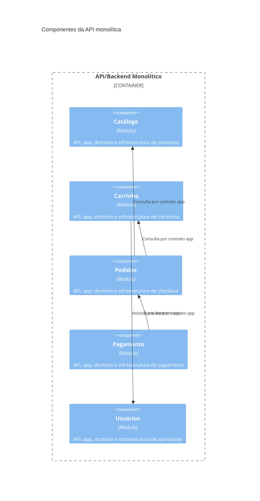
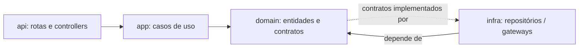

# C4 — Componentes

Visão alvo: cada módulo contém as camadas `api → app → domain → infra`. A seta domain → infra representa a associação com implementações dos contratos de domínio, não uma dependência de importação: `infra` depende de `domain`. Comunicações entre módulos devem usar somente contratos/casos de uso públicos de `app`. Os fluxos de negócio ainda não estão implementados.

Detalhamento de camadas, aplicável a cada um dos cinco módulos:

