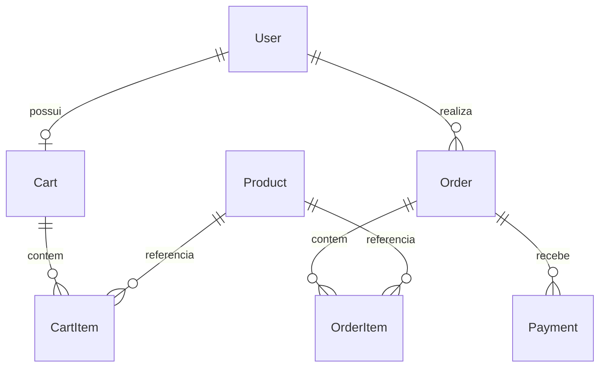

# Modelo de dados

Os IDs são UUID gerados pelo Prisma. Valores monetários usam `Decimal(12,2)`; o schema não define moeda. A validação de valores positivos e regras de estoque pertence à implementação futura.

| Tabela | Campos e significado |
|---|---|
| User | `id` UUID PK; `email` texto único; `passwordHash` texto; `role` texto, padrão `customer`. |
| Product | `id` UUID PK; `name` texto; `sku` texto único; `price` decimal; `stock` inteiro. |
| Cart | `id` UUID PK; `userId` UUID FK único para User: no máximo um carrinho por usuário. |
| CartItem | `id` UUID PK; `cartId` e `productId` UUID FKs; `qty` inteiro; `unitPrice` decimal. Par (`cartId`, `productId`) único. |
| Order | `id` UUID PK; `userId` UUID FK; `total` decimal; `status` texto padrão `pending`; `createdAt` data/hora padrão atual. |
| OrderItem | `id` UUID PK; `orderId` e `productId` UUID FKs; `qty` inteiro; `unitPrice` decimal. |
| Payment | `id` UUID PK; `orderId` UUID FK; `provider` texto; `status` texto padrão `pending`; `payload` JSON. |

Todos os campos acima são obrigatórios. Itens são excluídos em cascata quando seu carrinho ou pedido é excluído; as demais referências restringem exclusões. Há potencialmente vários pagamentos por pedido; estados, transições, idempotência e dados permitidos em `payload` precisam ser definidos antes do uso real.
